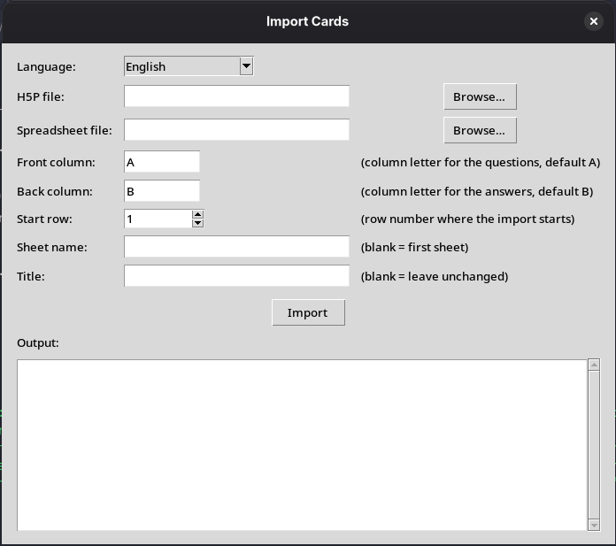

# H5P Import

For some H5P elements the configuration and content creation is very tedious because many
clicks and repeating steps have to be done. The scripts in this repo try to speed up
the process. The use case is: a teacher has word lists (vocabulary) for a foreigh language or
technical terms that need to be memorized. The [H5P Dialog Cards](https://h5p.org/dialog-cards),
[H5P Flashcards](https://h5p.org/flashcards) are suited. In the
[H5P Quiz (Question Set)](https://h5p.org/question-set) the
[H5P Fill in the Banks](https://h5p.org/fill-in-the-blanks) question type can be used. The
H5P files can be downloaded on [H5P.org](https://h5p.org).

The wordlist itself can be managed in a spreadsheet document.

## Requirements

The import script was tested on Linux and Windows. Further requirements are:

* an installed Python 3 environment
* the Python packages `odfpy` for Open Office documents and
`openpyxl` for Excel docuements
* a H5P file of the desired output type (H5P Flashcards, H5P Dialog Cards, or
H5P Quiz (Question Set) that must contain one Fill in the blanks question)


## Installation

From this repository the mandatory file is:

* `import-cards.py` does the import on the command line.

In addition there are:

* `import-cards-gui.py` that serves as a GUI wrapper and controls the cli import script without having
to use the command line.
* `import-cards-gui.bat` that can be used on Windows as a short cut to start the import process.

## Import wordlist from a shreadsheet at the command line

The script `import-cards.py` does the import on the command line. Basic usage is

```
python import-cards.py sample.h5p spreadsheet.ods
```

A sample call may look like:

```
python import-cards.py dialog-cards-1129.h5p words.ods
```

The h5p file is overwritten, so please use a copy from the existing example. The spreadsheet
is recognized by the file suffix `.ods` or `.xslx`.

The following optional command line arguments can be used:

* `--row N` start at row _N_ to skip header rows (default is 1).
* `--front X` the column for the front side of the card (the word that is given and must
be translated), default is _A_.
* `--back Y` the column for the back side of the card (the expected response), default is _B_.
* `--sheet <string>` the name of the worksheet in the table calculation document. When not
set, the first sheet is used.
* `--title <string>` a title that is used for the name of the H5P activity instance.

Each H5P type has it's advantages and drawbacks. Dialog cards just allow text and can be
easy flipping for self controlled learning. Flash cards allow the user to type in the
answer. Also, images and hints are supported in Flashcards (but are not used with this
script). The Quiz with the "fill in the blanks" works similar like the flash cards, the
user must type the answer as well.

When the answer must by typed, a single word should be expected as a response. Instead
of e.g. man/men for singular and plural, a task should ask for one form only and the
question should make it clear. Also, responses with a slash (e.g. man/men) do not work.

## GUI Wrapper

The GUI wrapper `import-cards-gui.py`, written in Python with TK, so that this
script should work on Linux, Windows and MacOS. The controls depend on the look an feel
of the OS. The script basically controls the command line tool by offering
controls for each of the possible arguments.



## Windows start script

To make things even easier for Windows user, the GUI wrapper in Python can be launched
with `import-cards-gui.bat` (via double click) which first checks the installed Python
environment, then checks whether the required libraries are installed and then launches
the GUI script to show the dialogue. This script can be used to create a link target on
the desktop or start menu.
